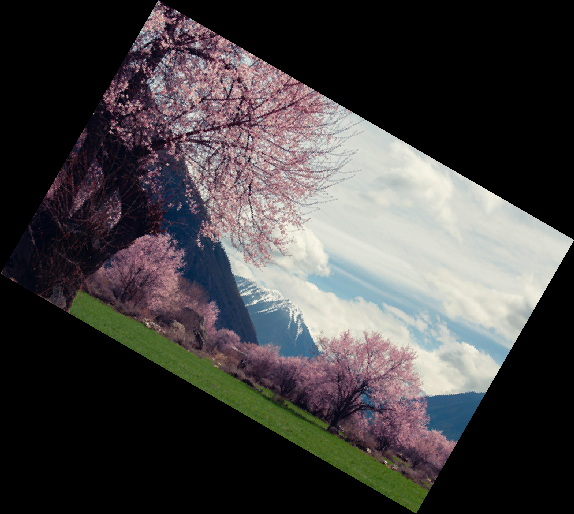
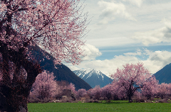
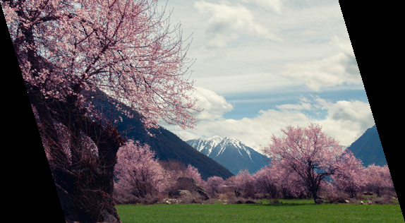
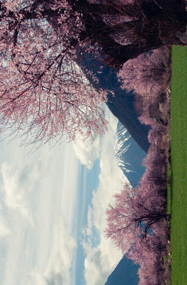
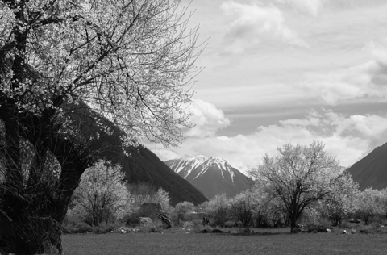
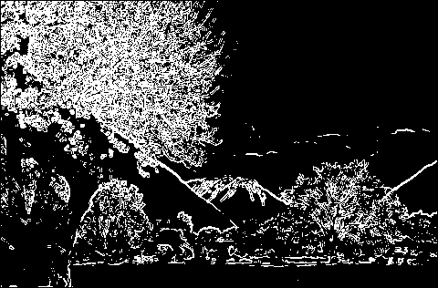

# Image Transformations from Scratch

A small Python library that edits images using linear algebra written by hand. Rotation, scaling, skew, transpose, grayscale and Sobel edge detection are all implemented with plain Python lists and my own matrix functions. Pillow is used only to read pixels from a file and write them back.

The goal was to understand what image libraries do underneath, not to be fast.

## Examples

| Original | Rotate 30° | Scale ×0.5 |
| --- | --- | --- |
|  |  |  |

| Skew (x = 0.3) | Transpose | Grayscale | Edge detection |
| --- | --- | --- | --- |
|  |  |  |  |

Example image from [Pixabay](add the image's Pixabay page link here), used under the [Pixabay Content License](https://pixabay.com/service/license-summary/), resized to 480 px wide for the examples.

## Features

**Matrix operations** (`Part X`): addition, subtraction, multiplication, transpose and scalar multiplication on lists of lists.

**Image transformations** (`Part Y`), each built on those operations:

| Transformation | How it works |
| --- | --- |
| Rotate | Rotation matrix around a chosen centre point, with inverse mapping |
| Scale | Inverse mapping with nearest-neighbour sampling |
| Skew | Shear: each pixel is shifted in proportion to its row (x) or column (y) |
| Transpose | Swaps rows and columns, mirroring the image along its diagonal |
| Grayscale | Weighted sum of the channels: 0.299·R + 0.587·G + 0.114·B |
| Edge detection | Sobel kernels applied to each 3×3 neighbourhood, then a threshold |

## How it works

**Images as matrices.** A colour image is split into three matrices, one per channel (red, green, blue), where each entry is a pixel brightness from 0 to 255. Every transformation is applied to each channel separately, and the three results are combined back into an image.

**Inverse mapping (rotate and scale).** The naive approach takes each source pixel and computes where it lands. That leaves holes, because rounding sends some output pixels no value at all. Instead, the code loops over every *output* pixel and applies the inverse transformation to find which source pixel it came from. Every output pixel gets exactly one value, so there are no gaps.

For rotation by angle θ around a centre (cx, cy), the source of an output pixel is:

```
src_x =  cos(θ)·dx + sin(θ)·dy + cx
src_y = -sin(θ)·dx + cos(θ)·dy + cy
```

where (dx, dy) is the output pixel's offset from the centre. Before that, the four corners are rotated to find how large the new canvas must be, so nothing is cut off. Because image y-coordinates point down, a positive angle turns the image clockwise on screen.

**Grayscale.** The channel weights reflect how sensitive the eye is to each colour: green looks brightest, blue darkest. The function uses the library's own `scalar_multiplication` and `matrix_addition`.

**Sobel edge detection.** Two 3×3 kernels measure how quickly brightness changes horizontally (Gx) and vertically (Gy). Each kernel and each pixel's 3×3 neighbourhood are flattened into a 1×9 and a 9×1 matrix, so the dot product is computed with the library's own `matrix_multiplication`. The edge strength is `√(Gx² + Gy²)`, and pixels above a threshold of 128 become white.

## Usage

Requires Python 3 and Pillow.

```bash
pip install pillow
python image_matrix_library.py
```

The program asks for an image path, a transformation (1–6), any parameters such as the angle or scale factor, and an output path. It then shows the result and saves it.

You can also import the functions directly:

```python
from PIL import Image
import image_matrix_library as lib

img = Image.open("photo.png")
R, G, B = lib.image_to_matrix(img)
grey = lib.to_grayscale(R, G, B)
edges = lib.edge_detection(grey)
```

## Limitations

- **Speed.** Pure Python loops are slow by design. On a 1920×1080 image, rotation takes about 4.5 s and edge detection about 5 s on a cloud test machine; the examples above use a 480×270 copy. NumPy would make this many times faster, but would hide the maths this project is about.
- **Nearest-neighbour sampling.** Rotate and scale pick the closest source pixel, so diagonal edges look slightly jagged. Bilinear interpolation would smooth them.
- **Negative skew.** Pixels shifted to negative coordinates fall outside the canvas and are cut off.
- **Fixed edge threshold.** 128 works for this example but not for every image; a parameter would be better.

## Background

Built as a group assignment at Twente Pathway College (2026) to apply linear algebra to image processing. I wrote most of the implementation.

## Author

Nikita Talan · [GitHub](https://github.com/nikitatalan)
